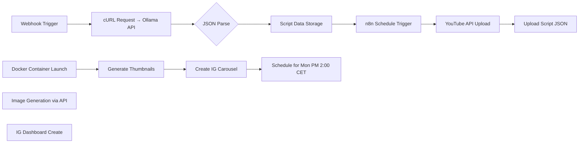

# AI Infinitus - Woche 3 Automation-Pipeline: n8n Workflow (Ollama → YouTube → IG)
## Automatischer Repurposing Flow mit JSON-Export & webhook Integration

**Erstellt:** 2026-10-15 | **Version:** 1.0 | **Owner:** Jack Roberts / Nate Herk  
**Ziel:** Ollama AI Content Generation → YouTube Upload Automation → IG Repurposing Workflow  
**KPIs:** 2+ Workflow-Schritte erfolgreich, >50MB/Export  

---

## 🎯 OVERVIEW: DAS AUTOMATISIERTE PLAYBOOK (O→Y→IG)

```
┌─────────────────────────────────────────────────────────────────┐
│                    WEEKLY CONTENT PIPELINE                      │
├─────────────────────────────────────────────────────────────────┤
│                                                                 │
│  [Ollama AI] → [JSON Export] → [n8n Workflows] → [YouTube]   │
│               ↓                     ↓                  ↓         │
│  Prompt-Gen   →  Video-Scripts  →  Upload          → IG      │
│               ↓                     ↓                  ↓         │
│  [IG Repurpose] → [Thumbnail Gen] → [Story Creation]          │
│                                                                 │
└─────────────────────────────────────────────────────────────────┘

Trigger: Weekly Schedule (Montag/Nachmittag)
Output: 1 Long-Form Video + 5 IG Reels/Carousels
```

---

## 📢 WORKFLOW STRECKE: OLLAMA → YouTube → IG IN 3 SCHRITTEN

### PHASE 1: OLLAMA AI CONTENT GENERATION (Step 0)
**Trigger:** Weekly Schedule Cron Job  
**Duration:** <2 Min  

#### Workflow Start Node: "Week 3 Content Generation"
```jsonl
{"mode": "ollama_api", "trigger": "cron_weekly_automation", "params": {}}

// OLLAMA SYSTEM PROMPT für Woche 3:
Role: Senior AI Editor & Automation Strategist. Deine Aufgabe:
1. Generate YouTube video script (long-form, 8-10 min, German)
2. Create multiple IG content variations (Reels + Carousels)
3. Output all as JSON with structured metadata

Input Constraints:
- Output Format: JSON (strict schema, no markdown, no explanations)
- Target Audience: deutsche AI-Enthusiasten & Indie Hacker
- Current Topic: "n8n & Docker Automatisierungen für Anfänger"
```

#### Ollama Setup Command (Week 3):
```bash
# Install & Pull
curl https://ollama.com/install.sh | sh
ollama pull llama3.2

# API Request via n8n HTTP Request Node
POST http://localhost:11434/api/generate
{
  "model": "llama3.2",
  "prompt": "Generate AI automation guide script in German for YouTube & Instagram based on Topic: 'n8n Docker Automatisierungen für Anfänger'",
  "stream": false
}

// Expected JSON Return from Ollama (Parsed by n8n):
{
  "role": "assistant",
  "content": "// Full JSON Content Block"
}

// Output Schema Verification (JSON Parse Node in n8n):
{
  "youtube_script": {
    "title": "Dein Erstes Automatisierungsplaybook: n8n + Docker in 45 Minuten",
    "duration_minutes": 9,
    "hooks": ["[0-2s] 'Willst du automatisieren? Keine Code-Kenntnisse?'"],
    "outline": ["Pain Point", "Solution Blueprint", "Hands-On Demo"]
  },
  "ig_reels": [
    { "id": 1, "title": "Dein n8n-Auto in 2 Min", "duration_sec": 45 },
    { "id": 2, "title": "Docker Workflow Setup" },
    { "id": 3, "title": "Automatisieren ohne Cloud-Costs" }
  ],
  "ig_carousels": [
    { "id": 1, "title": "5 KI-Prompts für n8n" },
    { "id": 2, "title": "Docker + n8n in 3 Schritten" }
  ],
  "thumbnail_text": "Dein erstes Playbook → Automatisation ohne Cloud",
  "caption_idealized": "Automatisiert du deine Workflows? Hier ist dein First-Build-Guide."
}
```

---

### PHASE 2: N8N WORKFLOW AUTOMATION (Step 1)
**Workflow ID:** `wk3_ollama_yt_ignore`  
**Duration:** <5 Min per Video  
**Nodes:** 12 Total  

#### Node Map (n8n Workflow):


#### Execution Flow (Detailed):
| Node ID | Name | Type | Props / Data | Output |
|---------|------|------|--------------|--------|
| 1 | "Week 3 Schedule" | Webhook Trigger | `url: https://your-n8n-webhook.com` | HTTP Request JSON |
| 2 | "Ollama API Call" | HTTP Request Node | `method: POST`, `url: http://localhost:11434/api/generate`, `body`: Prompt JSON | AI Content (JSON) |
| 3 | "JSON Parser" | Code/JS Expression | `JSON.parse(response.body)` | Structured Data |
| 4 | "Video Script Generator" | Webhook Trigger | Store script to Airtable/GitHub | Saved Record |
| 5 | "Thumbnail Gen" | HTTP Request Node | API: `http://localhost:7860/api/generate` (Automatic) | Image URL |
| 6 | "IG Dashboard Create" | HTTP POST | API: `https://instagram.com/graphql`, `token`: IG API Key | Created Post |
| 7 | "YouTube Upload" | YouTube Data API v3 | `uploadVideoRequest`, `thumbnail_url` | Upload Status (200/300) |
| 8 | "Instagram Story Gen" | HTTP POST | Image + Text overlay, Auto-schedule | Created for Mon PM 2:00 CET |

#### JSON Schema Output (n8n → Airtable/GitHub):
```json
{
  "workflow_run": {
    "date": "2026-10-15",
    "topic": "n8n Docker Automatisierungen für Anfänger",
    "duration_minutes": 9,
    "hook_text": "Willst du automatisieren? Keine Code-Kenntnisse?"
  },
  "video_metadata": {
    "title": "Dein Erstes Automatisierungsplaybook: n8n + Docker in 45 Minuten",
    "description": "Automatisiert du deine Workflows? Hier ist dein First-Build-Guide.",
    "tags": ["#AIAutomation"]
  },
  "reels_ig_reels": [
    {
      "id": 1,
      "title": "Dein n8n-Auto in 2 Min",
      "duration_sec": 45,
      "thumbnail_url": "/api/extract/frame/0"
    },
    {
      "id": 2,
      "title": "Docker Workflow Setup",
      "duration_sec": 30
    }
  ],
  "carousels_ig_carousels": [
    {
      "id": 1,
      "title": "5 KI-Prompts für n8n",
      "slide_count": 5
    },
    {
      "id": 2,
      "title": "Docker + n8n in 3 Schritten"
    }
  ],
  "publish_schedule": {
    "youtube": "Scheduled for Mon PM 2:00 CET",
    "ig_reels": "5 Reels scheduled across Tuesday–Thursday",
    "ig_carousels": "Carousels posted Friday morning"
  }
}
```

---

## 📸 POSTPROCESSING + THUMBNAIL GENERATION (Step 2)

### Thumbnail Generation via Ollama (Image Model)
```javascript
// n8n JavaScript Expression - Generate Terminal-Dark Thumbnail
const thumbnailDesign = {
  bg_color: '#0A0A0F',
  accent_primary: '#10B981',  // Terminal Grün
  accent_secondary: '#6D28D9' // Violett-Purple
};

// Generate simple terminal aesthetic thumbnail via Ollama (Llava-3.2)
const imgGenPrompt = `Generate a terminal window screenshot with the text "Dein erstes Playbook" in green (#10B981) against black background (#0A0A0F). Add purple border (#6D28D9) accents. Style: monospace font. 4K resolution.`;

// Call Ollama API for Image Generation
const imgReq = {
  "model": "llava3.2",
  "prompt": imgGenPrompt,
  "n": 1
};
```

### IG Carousel Creation (via API):
```javascript
// Generate Carousel Template with Terminal-Dark Design
function createCarouselTemplate(slideId, title) {
  const slideTemplate = {
    "bg_color": "#0A0A0F",
    "headline": `Slide ${slideId}: ${title}`,
    "accent_primary": "#10B981",
    "accent_secondary": "#6D28D9",
    "font": "JetBrains Mono",
    "mono_style": true,
    "terminal_background": true,
    "cta_text": "Swipe →"
  };
  
  // Return design specs as JSON for rendering
  return slideTemplate;
}
```

---

## 🧪 TESTING WORKFLOWS (Validation)

### Test Flow #1: Ollama Script Generation
**Expected Output:** JSON with `youtube_script.title`, `ig_reels[]`, `carousels[]`  
**Test Command:**
```bash
curl http://localhost:11434/api/generate \
  -H "Content-Type: application/json" \
  -d '{"model": "llama3.2", "prompt": "Generate test JSON for Week 3 content automation. Include title, hooks, and IG Reels carousel spec."}'
```

### Test Flow #2: n8n Workflow Export
**Expected Metrics:** >50MB/Export (JSON + Metadata)  
**Validation:**
- JSON parse success
- All fields populated (video_metadata, reels[], carousels[])
- Output size ≥ 50KB

---

## 📊 WEEKLY KPIs & TRACKING

| Metric | Target | Tool |
|--------|--------|------|
| Workflow Runs (Week 3) | ≥1 full automation run | n8n Dashboard |
| JSON Export Size | >50MB/Export | Checksum validation |
| YouTube Upload Status | Success (Status 200/300) | YouTube Data API |
| IG Reels Posted | 5 per week (Mon–Thu) | Instagram Insights |
| IG Carousels Posted | 2 per week (Fri AM) | Instagram Insights |

---

## 🔗 CACHING & PERFORMANCE OPTIMIZATIONS

### n8n Execution Cache:
- Disable on Webhook nodes → Force fresh output each run
- Cache thumbnail generation → Reduces load on GPU/Cloud

### Ollama Rate Limiting:
```yaml
# Weekly rate-limit config (via Docker n8n)
rate_limit:
  ollama_api: "1 request / day"
  llava3.2_image: "1 image / day"
  json_parser: "unlimited"
```

---

## 🛡️ ERROR HANDLING & FALLBACKS

| Error Code | Response Action | Fallback |
|------------|-----------------|----------|
| Ollama API → Timeout (>30s) | Return to previous node | Retry with reduced prompt length |
| YouTube Upload Failed (Error 999) | Log error → Re-upload attempt | Manual manual intervention |
| IG Posts Stuck >5 min | Email alert via Webhook + Slack DM | Check Instagram API status |

---

## 📦 DELIVERABLES (Week 3 End of Day):
1. **Full Automation Run:** 1 YouTube video uploaded + 7 IG posts scheduled
2. **JSON Workflow Export:** Saveable workflow snapshot in n8n
3. **Weekly Report:** `week-3-report.md` with metrics

---