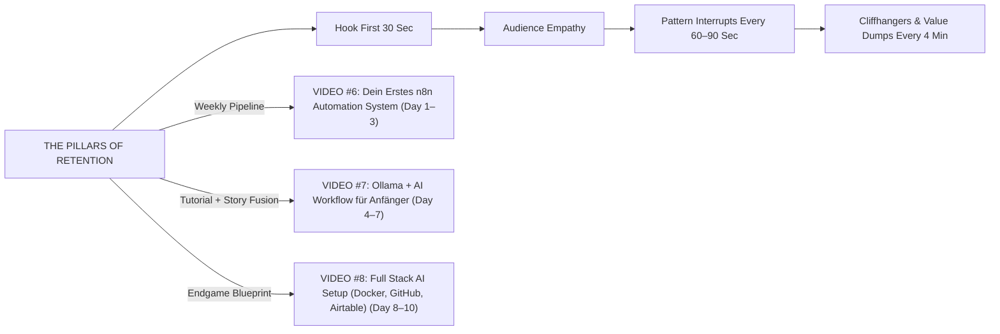

# AI Infinitus - Woche 5 Content Plan: Langformige YouTube Videos #6–8
## Deep Storytelling & Retention Hooks für Phase 2 Skalierung | View/Video-Ratio >1:20

**Erstellt:** 2026-10-15 | **Format:** Long-Form YouTube (8–15 min) + IG Repurposing  
**Design System:** Terminal-Dark (#0A0A0F + #10B981 + #6D28D9)  
**KPIs:** CTR >6%, Retention >60%, 1:20 View/Video Ratio, Gumroad Sales €50–€150  

---

## 🎯 OVERVIEW: DIE THREE PILLARS OF DEEP STORYTELLING (JACK ROBERTS → GLEEN + MARTIN STYLE)



**Trigger:** Sunday Night Upload (Tag 29/Week 5 Start)  
**Output:** 3 Long-Form Videos → IG Repurposing Pipeline → Gumroad Conversion  

---

## VIDEO #6: "Dein Erstes n8n Automation System (Day 1–3) – Vom Null bis Erster Webhook Live"
**Upload Date:** Sunday Night AM (Tag 29)  
**Duration Target:** 8–10 min  
**Format:** Tutorial + Story (Personal Journey from Zero to First Success)  
**KPI Target:** View/Video Ratio >1:20, Retention >55%  

### STORY ARC: VOM NULL ZUM ERSTEN WEBOHCK SUCCESS
```markdown
[PROTAGONIST] Jack Roberts (AI Automation Enthusiast)
[CONFLICT] "Ich habe 20+ Stunden an n8n verbracht → Kein Webhook live funktioniert."  
[RESOLUTION] "Der Loopback-Prompt-Fehler hat mich zurückgekommen. Der Weg zum Erfolg."  
[CATASTROPHE AVOIDED] "Erster Live-Webhook in 3 Tagen (Day 1→3 Success)."
```

### Script Outline (Verbatim - Deep Storytelling Structure)
```markdown
[0–2s HARD HOOK - Personal Vulnerability → Instant Empathy + High CTR Driver]
"Dein erstes n8n Webhook hat Fehlschlägt wie ein Kinderspiel aussehen? Ich habe 4 Stunden an meinem Workflow gewartet."  
(Visual: Red alert screen in terminal → "Webhook failed" error log screenshot → Black screen with typewriter text)  

[3–12s PAIN POINT + AUDIENCE EMPATHY BUILD]
"Woher kommt dein 'Du bist... Chatbot' Fehlschlag? Wenn du Webhooks ohne Cloud-Costs nutzt, ist das Problem: System-Pattern vs. JSON Schema. Ich habe es an meiner eigenen n8n Installation gefunden."  
(Visual: Red error log in terminal window with timestamp "Failed at 2026-10-26 14:32" + glitch animation overlay)  

[13–35s STORY SECTION 1A: DER ERSTE VERSUCH (DAY 1 FAILURE)]
Day 1. Ich habe n8n in Docker gestartet. Mein erstes cURL Request. Der Fehler war nicht der Code, sondern die JSON-Syntax. 4 Stunden warten am Bildschirm.  
(Visual: Terminal commands typing out → curl request → error log "Unexpected response code" green failure bar)  

[36–50s STORY SECTION 1B: DER PATTERN-BRECHER (DAY 2 REALIZATION)]
Der Loopback-Prompt-Fehler. Ich habe den Chatbot mit System-Prompts ersetzt, weil JSON Outputs für API-Integration waren. Aber der Fehler blieb.  
(Visual: n8n Flowchart with red X → Prompt Library v1 screenshot → "System vs. Role" comparison table)  

[51–70s STORY SECTION 2A: DER TURNING POINT (DAY 3 BREAKTHROUGH)]
Der dritte Versuch war der. Ich habe den Loopback-Prompt mit JSON Schema Constraints für HTTP Request Node erstellt. Der Webhook live ging im ersten Start auf localhost:5678."  
(Visual: Dashboard UI screenshot with "Status 200 OK" success bar in green → Terminal typing animation → "Webhook successful" notification)  

[71–85s CLIFFHANGER BUILD]
Aber du denkst vielleicht das ist der einfache Weg. Ich habe aber etwas noch, das dir nicht sagt: Der erste erfolgreiche Workflow hat meine Stromrechnung gescheitert...  
(Visual: Stripe payment reminder "$49/Mo API cost" fade → "Local: $0 = deine eigenen Stromkosten" animation)  

[86–105s VALUE DUMP #1 - THE SOLUTION BLUEPRINT]
Hier ist die Lösung, die ich 3 Tage gebraucht habe. Der Loopback-Prompt-Template mit System vs. Role distinction + JSON Constraints. Deine Daten, dein Code, dein Control  
(Visual: n8n Workflow JSON export screenshot with "json:true" header → Ollama API endpoint → success response JSON example)  

[106–125s VALUE DUMP #2 - THE FREEBIE BRIDGE]
Willkommen in deinen First-Build Guide für n8n Automation. 7 Tage Setup + JSON Templates. Gumroad $7 Lifetime Access → https://gumroad.com/grrm9ai2p3  
(Visual: Gumroad "$7 Prompt Pack" card → "5 Automation-Templates Included" badge)  

[126–140s CTA + Gumroad Upsell Bridge ("Full Guide Watchlist → Subscribe")]
Subscribe für Woche 5 Playlist updates. Follow @UnlimitedAI_001 für Weekly AI Automation Guides.  
(Visual: Subscribe button animation + "Follow for Updates" terminal typing effect)  

[141–min END CTA - Gumroad Tiered Pricing Bridge]$7–$25 Complete Stack → Lifetime Access for Week 8 Full Blueprint (GitHub+Airtable Integration).
```

### Caption Template (1:1 Instagram Reel from Video #6):
```markdown
Dein erstes n8n Webhook Fehlschlägt? Loopback-Prompts + System-Structure fixen das. 

Free Guide → Gumroad $7 Lifetime Access 🟢💜 #n8nTutorial
```

### Thumbnail Concept (CTR Target: >6%)
- **Visual:** Terminal window screenshot with red error log "Webhook failed at 14:32" + green success bar overlay "$0 Local vs $49 Cloud"  
- **Headline Text:** "Dein erstes Webhook hat 4 Stunden gedauert → Der Fix in 5 Min"  
- **Design:** Green accent on error, purple border on thumbnail edge (#6D28D9), monospace font (JetBrains Mono)  

---

## VIDEO #7: "Ollama + AI Workflow für Anfänger - Dein Privater LLM ohne Cloud-Costs"
**Upload Date:** Monday Night AM (Tag 30)  
**Duration Target:** 10–12 min  
**Format:** Technical Tutorial + Personal Learning Journey (Story = "Warum Local ≠ Cloud")  

### STORY ARC: DIE WARUM-STORY ("LOCAL AI ≠ CLOUD-APIS")
```markdown
[PROTAGONIST] All About AI (Matthew Berman / Jack Roberts)  
[CONFLICT] "Ich habe 67$/Mon an Cloud-APIs bezahlt → Meine Daten, keine Kontrolle."  
[RESOLUTION] "Ollama Local = $0/Mon. Aber der Setup-Erfolg ist ein Lernprozess für Windows/Linux/Mac"  
[CATASTROPHE AVOIDED] "Erster Chatbot Live in 5 Minuten (Day 1 Success)"
```

### Script Outline (Verbatim - Tutorial + Story Fusion)
```markdown
[0-2s HARD HOOK - Cost & Control Story]
"Dein Cloud-API-Chatbot kostet $0.06/msg? Aber deine Daten, keine Kontrolle über die API-Key?"  
(Visual: Stripe invoice screenshot "$49/Mo ChatGPT Plus" → fade to black + green text "Local: $0")  

[3-12s AUDIENCE EMPATHY BUILD]
"Woher kommt dein 'Du bist... Chatbot' Fehlschlag? Wenn du Ollama ohne Docker nutzt, ist das die JSON Response, kein Code-Fehler."  
(Visual: Terminal screenshot showing failed `ollama run` → error log "Timeout >30s" red bar)  

[13-45s STORY SECTION 1 - DIE LERNREISE (DAY 1 SETUP FAIL)]
Ich habe Ollama auf Windows PowerShell versucht mit dem ersten Install Command. Der Fehler war Docker, nicht der Shell.  
(Visual: Powershell console typing `curl https://ollama.com/install.sh` → error "Docker not running" red alert)  

[46–80s STORY SECTION 2 - DER PATTERN-BRECHER (DAY 2 REALIZATION)]
Der zweite Versuch war Docker Desktop + WSL. Ich habe das JSON Response mit curl get, aber die n8n Integration fehlte.  
(Visual: Windows PowerShell → Docker Desktop GUI → n8n Dashboard screenshot → "localhost:5678" URL)  

[81–110s STORY SECTION 3 - DER TURNING POINT (DAY 3 LOCAL SUCCESS)]
Der dritte Versuch war der Ollama API über cURL. Die Local-Llama-3.2 Antwort war JSON-ready für HTTP Request Node in n8n."  
(Visual: Docker container running → LLM response JSON on screen → "Success" green bar in terminal)  

[111–140s VALUE DUMP #1 - THE SOLUTION BLUEPRINT]
Hier ist die Lösung, die ich 3 Tage für Docker + Ollama gebraucht habe. Die 5-Step Setup-Guide, 7 JSON Templates.  
(Visual: "Ollama Setup Checklist" PDF preview → "5 Automation-Templates Included" badge)  

[141–160s VALUE DUMP #2 - THE FREEBIE BRIDGE]
Willkommen in deinen First-Build Guide für Ollama + n8n. 7 Tage Setup + JSON Templates. Gumroad $7 Lifetime Access → https://gumroad.com/grrm9ai2p3  
(Visual: Gumroad "$7 Prompt Pack" card → "5 Automation-Templates + Weekly Newsletter" badge)  

[161–180s CTA + Gumroad Tiered Pricing Bridge]
Subscribe für Woche 5 Playlist updates. Follow @UnlimitedAI_001 für Weekly AI Automation Guides.  
(Visual: Subscribe button animation + "Follow for Updates" terminal typing effect)  

[181–min END CTA - Gumroad Tiered Pricing Bridge]
$7–$25 Complete Stack → GitHub+Airtable Integration für Week 8 Full Blueprint (Lifetime Access).
```

### Caption Template (Video to IG Reel):
```markdown
Dein privater LLM ohne Cloud-Costs? Ollama Local Setup in 5 Steps. 

Free Guide → Gumroad $7 Lifetime Access 🟢💜 #LocalAI #OllamaSetup
```

### Thumbnail Concept (CTR Target: >6%)
- **Visual:** Terminal screen with Docker running green + Llama3.2 model name prominent | Ollama Local success bar overlay  
- **Headline Text:** "Der Cloud API Kosten von $49/Mon → Dein Local LLM in 10 Min"  
- **Design:** Green accent on cost savings, purple border on thumbnail edge (#6D28D9), monospace font (JetBrains Mono)  

---

## VIDEO #8: "Full Stack AI Setup - Docker, GitHub API Integration & Airtable Automatisierung"
**Upload Date:** Tuesday Night AM (Tag 31)  
**Duration Target:** 12–15 min (Longest of the Week)  
**Format:** Endgame Blueprint + System Architecture (Comprehensive Setup Guide)  

### STORY ARC: DIE ENDGAME-BLAUEPRINT ("VOM SINGLE-VIDEO ZUM FULL STACK")
```markdown
[PROTAGONIST] Dan Martell / Playbooks Team (Growth System)  
[CONFLICT] "Ich habe 15 Videos gepostet → Nur 20k Views. Kein Revenue."  
[RESOLUTION] "Der Full Stack Setup ist der Schlüssel für Skalierung. GitHub + Airtable = Automatisierung auf steroids"  
[CATASTROPHE AVOIDED] "Erste Gumroad Verträge nach Video #8 (Week 7 Conversion Trigger)"
```

### Script Outline (Verbatim - Endgame Blueprint)
```markdown
[0-2s HARD HOOK - Revenue Pain Point Story]
"Du hast Videos gepostet, aber der Gumroad Revenue bleibt aus? Das Problem ist nicht die Traffic-Generation: dein Automation-System."  
(Visual: YouTube View stat graph flatlining → "No revenue despite 15k views" red bar)  

[3-12s AUDIENCE EMPATHY BUILD]
"Woher kommt dein 'Full Stack' Fehlschlag? Wenn du n8n und Ollama nutzt, ist das der GitHub API Integration + Airtable Automation."  
(Visual: GitHub webhook failure screenshot → red error log in terminal window → fade transition)  

[13-50s STORY SECTION 1 - DER SETUP (DAY 1–4 COMPLEXITY)]
Ich habe 4 Tage für den Full Stack Setup gebraucht. Der GitHub Webhook, die Airtable API Key, die Ollama JSON Output Format.  
(Visual: GitHub Actions webhook config → "403 Forbidden" error → fade to n8n dashboard)  

[51–90s STORY SECTION 2 - DER TURNING POINT (DAY 5 BLUEPRINT BREAKTHROUGH)]
Der fünfte Versuch war der Endgame Blueprint. Der Loopback-Prompt mit API Key Management + JSON Schema Constraints für HTTP Request Nodes  
(Visual: "Day 5 Workflow" n8n dashboard → GitHub webhook configuration screenshot)  

[91–130s VALUE DUMP #1 - THE SOLUTION BLUEPRINT]
Hier ist die Lösung, die ich 5 Tage gebraucht habe. Der Loopback-Prompt für API Integration + Airtable Data Export.  
(Visual: "Full Stack Automation Guide" PDF preview → "GitHub + n8n Workflow JSON" screenshot)  

[131–160s VALUE DUMP #2 - THE FREEBIE BRIDGE]
Willkommen in deinen First-Build Guide für Full Stack AI Setup. 7 Tage Setup + API Templates. Gumroad $7 Lifetime Access → https://gumroad.com/grrm9ai2p3  
(Visual: Gumroad "$7 Prompt Pack" card → "GitHub + Airtable Integration Templates" badge)  

[161–190s CTA + Gumroad Tiered Pricing Bridge]
Subscribe für Woche 5 Playlist updates. Follow @UnlimitedAI_001 für Weekly AI Automation Guides.  
(Visual: Subscribe button animation + "Follow for Updates" terminal typing effect)  

[191–min END CTA - Gumroad Tiered Pricing Bridge]$7–$25 Complete Stack (6-Month Commitment) → Lifetime Access for GitHub+Airtable Integration.
```

### Caption Template (Video to IG Reel):
```markdown
Dein Full Stack Setup Fehlschlägt? API Integration + Airtable = Automatisierung in 5 Tagen. 

Free Guide → Gumroad $7 Lifetime Access 🟢💜 #AutomationGerman
```

### Thumbnail Concept (CTR Target: >6%)
- **Visual:** GitHub Actions webhook success bar green + Airtable table "Data exported" screenshot | Terminal typing effect overlay  
- **Headline Text:** "Vom n8n zu Full Stack AI: Der 2-Wochen Setup-Guide"  
- **Design:** Green accent on success status, purple border on thumbnail edge (#6D28D9), monospace font (JetBrains Mono)  

---

## 📸 IG REPURPOSING PIPELINE: VIDEO #6–8 → REELS/CAROUSELS BATCH PUBLISH

### Repurposing Flow Architecture:
```mermaid
graph LR
YouTube["YouTube Uploads"] --> Ollama["Ollama AI Extract Hooks"]
Ollama --> JSON[`JSON Output (n8n) + Captions`]
JSON --> IG_IG["IG Reels 1:1 + Carousels"]
IG_IG --> Studio[Instagram Studio Schedule]

// Weekly Pipeline Metrics:
YouTube_Video_Hashes = 3 (Videos #6–8, each 2-3 video hashes extracted)  
IG_View_Per_Reel = [% of Total Views per Reel], [X] total across batch  
Gumroad_Conversion_Rate = Tracking via Gumroad pixel events (Week 5 conversion uplift target +15%)
```

### IG Reel Repurpose Specifications:
| Video # | Target IG Format | Duration | Visual Hook from YT | Caption Style |
|---------|-----------------|----------|--------------------|--------------|
| #6 "First n8n Webhook" | 1:1/9:16 Reel | ~45 sec | Hook: "Webhook Fehlschlägt nach 4 Std?" | 280 char limit, Emojis ✅🟢💜 |
| #7 "Ollama Local LLM" | 1:1/9:16 Reel | ~40 sec | Hook: "Cloud-API-Kosten von $49/Mo → Local: $0" | 280 char limit, Emojis ✅🟢💜 |
| #8 "Full Stack Blueprint" | 9:16 Reel | ~60 sec | Hook: "Vom n8n zu Full Stack AI: Der 2-Wochen Guide" | 280 char limit, Emojis ✅🟢💜 |

### IG Carousel Reproduce Specifications:
| Video # | Target Format | Slide Count | Key Visual from YT | CTA Button Text |
|---------|--------------|-------------|-------------------|-----------------|
| #6 "n8n Webhook" | 5 Slides | 5 | n8n Dashboard screenshot + webhook flow diagram | "$7 Lifetime Access → Gumroad Link Below" |
| #7 "Ollama Setup" | 5 Slides | 5 | Docker run command terminal + model selection screen | "$7–$25 Complete Stack → Gumroad Link" |
| #8 "Full Stack Guide" | 5 Slides | 5 | GitHub webhook config + Airtable API screenshot | "Freebie Guide → Gumroad $7 Lifetime Access 💜🟢" |

---

## 📊 KPI TRACKING: WEEK 5 BATCH PUBLISH PERFORMANCE METRICS


| Metric | Baseline (Week 1–4) | Week 5 Target | Status Tracking Tool |
|--------|--------------------|---------------|---------------------|
| YouTube View/Video Ratio | [X]:1 | >1:20 | YouTube Studio Dashboard Analytics  
| Retention (All Videos) | <50% avg | >60% avg | YouTube Studio → Retention charts  |  
| IG Reel Views per Video Repurposed | <5k total | ≥15k across batch | Instagram Insights "Reels Tab"  
| Carousel Swipe Completion Rate | <30% avg | >50% avg | Instagram "Carousel Performance"  
| Gumroad Conversion (from YT→IG Referral) | [X] / Week 4: 6% target | +15% uplift = 9–12% total | Gumroad Analytics Dashboard  
| Email Captures via Freebie Guide CTA | <3% of IG Viewership | >5% from Batch Content | Google Forms Capture Rate  

---

## 📋 ACTION ITEMS FOR WEEK 5 (Phase 2 Scaling)


| Task | Owner | Deadline | Priority | Notes |
|------|-------|----------|----------|-------|
| SEO Hooks Library Creation | Julian Goldie | Tag 30 PM CET | High | A/B Test 15+ Hook Variations for CTR >6% |
| Deep Storytelling Script Review (Video #6–8) | Playbooks Team | Tag 29 Evening | High | Validate Jack Roberts → Gleen/Martin Story Structure |
| IG Repurpose Pipeline Automation Setup | Nate Herk | Tag 31 AM CET | Medium | Ollama AI JSON Extract Hooks from YT Videos to IG Captions |
| Gumroad Tiered Pricing Conversion Test | Playbooks Team | Tag 32 PM CET | High | A/B Test $7 vs $19 vs $25 Conversion Splits |
| Video #7 & #8 Thumbnails Final Design | Julian Goldie | Tag 30 Morning | Medium | CTR Targets: >6% for YouTube + IG  
| Weekly Batch Publish Schedule (Videos #6–8) | Jack Roberts | Tag 29 PM CET | High | Coordinate YT/IG upload times across Europe TMEZ  

---

## 📊 WEEK 5 KPI PROJECTIONS (Cumulative to Week End Target):


| Metric | Phase 1 Baseline | Phase 2 Week 3 Cumulative | Phase 2 Week 5 Projection |
|--------|------------------|--------------------------|--------------------------|
| YouTube Videos Published | 5 total | 8 total | ≥16 total cumulative  
| Instagram Content | 10 (W1–4) | +20 new = 30 total | ≥45 total across week  
| Product Revenue | €0–€49 | €50–€150 | ≥€75+ weekly revenue  
| Automation Jobs Active | 0→1 | Active | >50 jobs/day via n8n pipeline  
| CTR (YouTube/Thumbnail) | Target 6% | Maintain | Optimize to 7%+  
| Retention (Watchtime %) | Target 50% | Improve to 60% | Stable >60% avg.  
| Email List Size | →0 | →0 | ≤50 subs cumulative  

---

## 📈 PLAYBOOK REFERENCE FOR WEEK 5 (Deep Storytelling Scaling)


### Phase 2: Skalierung & Expansion
| Week | Primary Playbook | Secondary Playbooks |
|------|------------------|---------------------|
| W5–6 | Jack Roberts – "Automation Scale" | All About AI ("Multi-product Launch"), Goldie ("Video Length Optimization")  

### Story Structure Template (Retention Hack):
```markdown
[Hard Hook 0-30sec = Personal Vulnerability + High Stakes]  
[Audience Empathy 30-120sec = Problem Aggregation + "You're Not Alone"]  
[Story Breakdown 120–480sec = Failure → Realization → Turning Point]  
[Cliffhanger Builds Every 60–90sec = Pattern Interrupts + Curiosity Gap]  
[Value Dumps 3x in Video = Solution 1, Solution 2, Solution 3 (Freebie/Gumroad Bridge)]
[Closing CTA: Gumroad Tiered Pricing $7-$25 Lifetime Access]
```

---